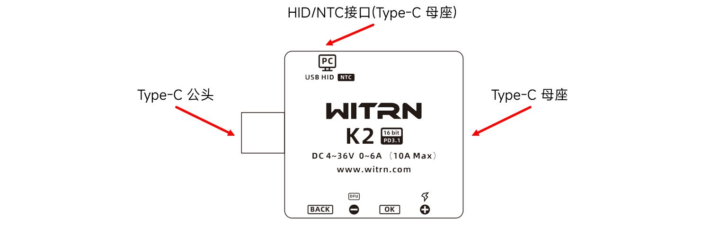
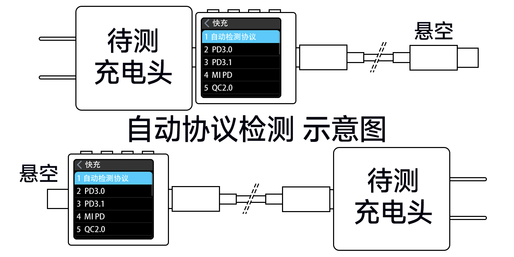
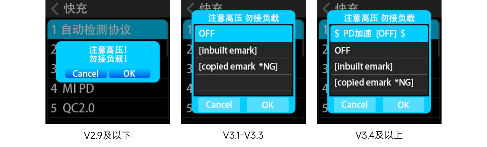
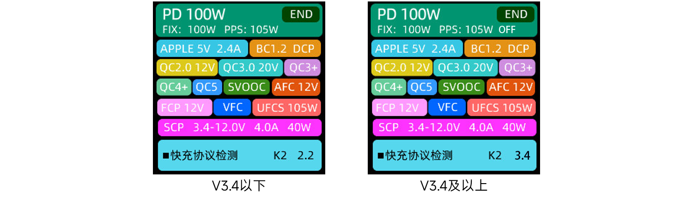
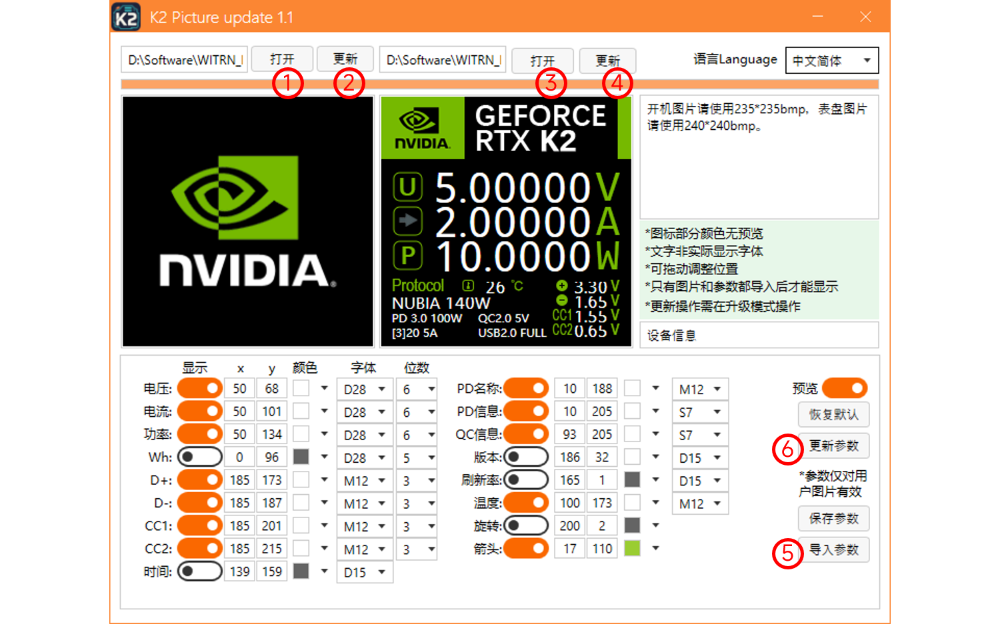
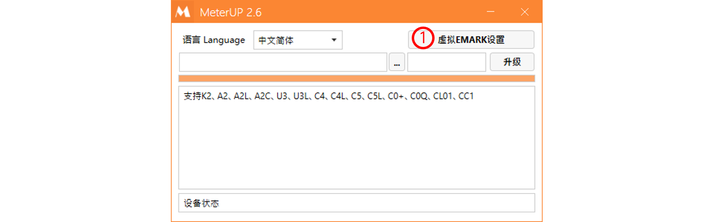
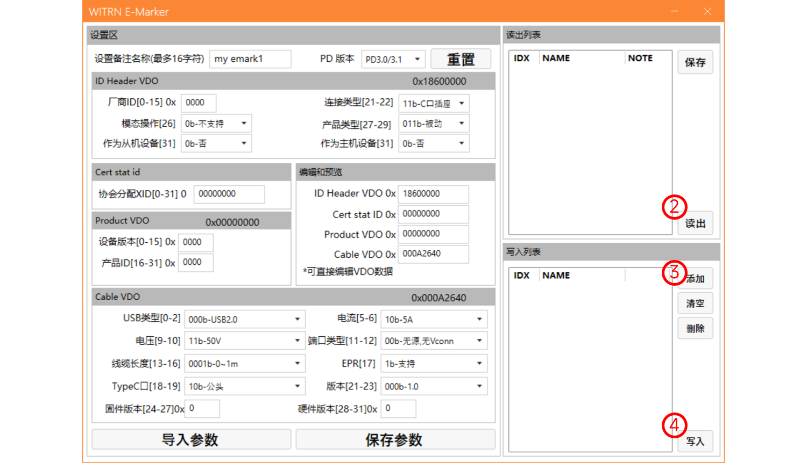
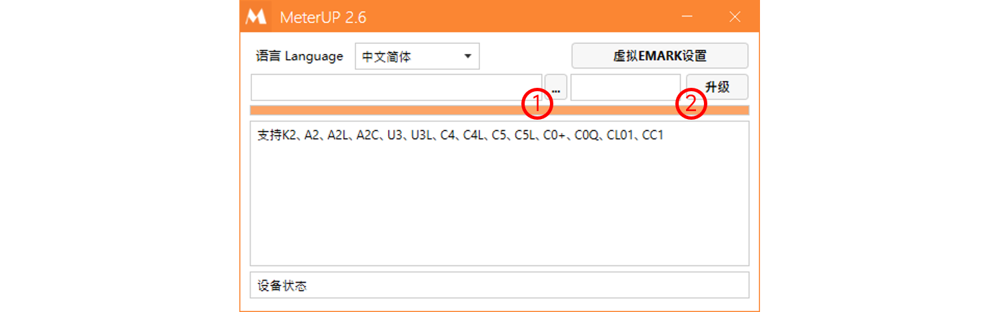
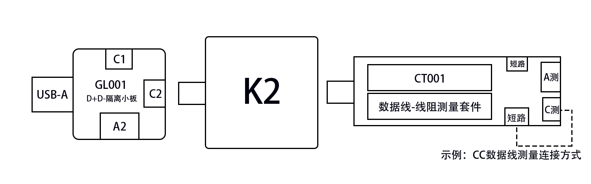

# Sổ tay tra cứu nhanh WITRN K2

  

[中文](README.md) | **Tiếng Việt**

> Đây là bản dịch tiếng Việt của [README.md](README.md). Nếu có khác biệt, vui lòng lấy bản tiếng Trung làm chuẩn. Tên các mục trên menu của K2 được giữ nguyên tiếng Trung trong ngoặc để bạn dễ đối chiếu với màn hình máy.

## Mục lục

- [1 Giới thiệu cơ bản về K2](#1-giới-thiệu-cơ-bản-về-k2)
- [2 Khởi động và sáng màn hình](#2-khởi-động-và-sáng-màn-hình)
- [3 Công suất](#3-công-suất)
- [4 Kiểm tra và kích giao thức sạc nhanh](#4-kiểm-tra-và-kích-giao-thức-sạc-nhanh)
- [5 Mặt đồng hồ](#5-mặt-đồng-hồ)
- [6 E-Marker](#6-e-marker)
- [7 Firmware](#7-firmware)
- [8 Phần mềm máy tính](#8-phần-mềm-máy-tính)
- [9 Điện trở dây cáp](#9-điện-trở-dây-cáp)

## Lưu ý trước khi đọc

Sổ tay tra cứu nhanh này **không phải tài liệu chính thức**, mọi nội dung đều lấy hướng dẫn sử dụng chính thức làm chuẩn: [Hướng dẫn sử dụng chính thức WITRN K2](https://www.witrn.com/?p=2105).

Sổ tay này nhằm giúp những người lần đầu dùng đồng hồ đo điện áp/dòng điện WITRN K2, tổng hợp một số câu hỏi thường gặp. Bạn có thể dùng mục lục ở trên để nhảy nhanh đến nhóm câu hỏi mình cần, hoặc đọc lần lượt từng mục để có kiến thức nền tương đối đầy đủ. Nếu bạn đã có nhiều kiến thức nền hoặc đã dùng K2 thành thạo, sổ tay này có thể không giúp được nhiều cho bạn.

Nếu trong lúc đọc bạn gặp từ ngữ khó hiểu, có thể xem giải thích chi tiết qua chú thích cuối trang đã đặt sẵn[^1]. Nếu không có chú thích mà bạn vẫn chưa hiểu, hãy báo cho chúng tôi bằng bất kỳ cách nào (ví dụ issue, nhóm QQ…). Cũng có thể phần đó thật sự không cần thiết với bạn (không có ý chê bai), cứ bỏ qua là được.

Nếu bạn muốn cùng chúng tôi duy trì Sổ tay tra cứu nhanh WITRN K2, hãy gửi PR tại [kho Github](https://github.com/JohnScotttt/WITRN-K2-Quick-Reference-Manual).

## 1 Giới thiệu cơ bản về K2

### Mục lục
- [1.1 Ba cổng kết nối](#11-ba-cổng-kết-nối)
- [1.2 Bốn nút bấm](#12-bốn-nút-bấm)
- [1.3 Trang thứ nhất](#13-trang-thứ-nhất)
- [1.4 Trang thứ hai](#14-trang-thứ-hai)
- [1.5 Trang thứ ba](#15-trang-thứ-ba)
- [1.6 Trang thứ tư](#16-trang-thứ-tư)

### 1.1 Ba cổng kết nối

**Đầu đực Type-C**: cắm vào điện thoại hoặc cổng của củ sạc

**Cổng cái Type-C**: cắm cáp sạc

**Cổng HID/NTC**: cắm cáp sạc để cấp nguồn riêng, hoặc kết nối phần mềm máy tính[^2] (đồng thời cấp nguồn riêng), hoặc gắn một đầu dò nhiệt độ (NTC)

**Lưu ý**: Chiều mạch đúng của K2 là **từ trái sang phải** hoặc **từ phải sang trái** theo hình. Cổng cái HID ở phía trên chỉ cấp nguồn cho bản thân K2, **không liên quan** đến mạch gốc.

### 1.2 Bốn nút bấm

**`BACK`**: quay lại/thoát

**`-`**: chuyển màn hình về trước/điều chỉnh/chọn giảm; giữ nút này khi cấp nguồn để vào chế độ nâng cấp DFU

**`OK`**: xác nhận/thực hiện/lưu/vào

**`+`**: chuyển màn hình về sau/điều chỉnh/chọn tăng; giữ nút này khi cấp nguồn để lấy điện từ PD

### 1.3 Trang thứ nhất

Nhấn nhanh **`BACK`** để khóa/mở khóa xoay màn hình, khi đang khóa thì nhấn giữ **`BACK`** để xoay màn hình; nhấn nhanh **`OK`** để xem danh sách PDO[^3]/RDO[^4] (nếu có), nhấn giữ **`OK`** để đổi tần số làm mới màn hình.

### 1.4 Trang thứ hai

Nhấn nhanh **`BACK`** để chuyển nhóm ghi; nhấn nhanh **`OK`** để lưu giá trị MAX và AVG, nhấn giữ **`OK`** để xóa bản ghi năng lượng/dung lượng của nhóm hiện tại, đồng thời xóa MAX và AVG.

### 1.5 Trang thứ ba

Nhấn nhanh **`OK`** để đổi tần số lấy mẫu.

### 1.6 Trang thứ tư

**Sạc nhanh** (快充): vào trang kiểm tra giao thức sạc nhanh

**Công cụ** (工具): vào trang công cụ

**Hướng** (方向): chọn khóa/mở khóa hướng màn hình

**Cài đặt** (设置): vào trang cài đặt

## 2 Khởi động và sáng màn hình

### Mục lục

- [2.1 Làm sao để khởi động hoặc sáng màn hình](#21-làm-sao-để-khởi-động-hoặc-sáng-màn-hình)
- [2.2 Vì sao cắm cáp mà màn hình không sáng](#22-vì-sao-cắm-cáp-mà-màn-hình-không-sáng)
- [2.3 Vì sao giữ nút tia sét rồi cắm cáp mà màn hình vẫn không sáng](#23-vì-sao-giữ-nút-tia-sét-rồi-cắm-cáp-mà-màn-hình-vẫn-không-sáng)
- [2.4 Vì sao rút điện thoại ra thì màn hình tắt](#24-vì-sao-rút-điện-thoại-ra-thì-màn-hình-tắt)
- [2.5 Vì sao màn hình hiện “K2 DFU”](#25-vì-sao-màn-hình-hiện-k2-dfu)

### 2.1 Làm sao để khởi động hoặc sáng màn hình

Cả đầu đực và cổng cái Type-C ở hai bên trái phải của K2 đều có thể cấp nguồn. Bạn có thể cắm cáp Type-C vào cổng cái, hoặc cắm đầu đực của K2 vào củ sạc để khởi động/sáng màn hình.

**Lưu ý**: Dù bạn dùng loại cáp nào (cáp A-C hay C-C), hay cắm thẳng vào củ sạc, chúng tôi khuyên bạn luôn nhấn giữ **`+`** khi cấp nguồn, như hình dưới

**Ghi chú**:

> WITRN có cung cấp một cách khởi động khác: nhấn **`OK`** để khởi động. Tuy nhiên cách này có nhiều hạn chế, thường không khuyến khích dùng.
>
> Nếu bạn chỉ dùng K2 như một thiết bị theo dõi quá trình sạc thì không cần thao tác khởi động gì cả, chỉ cần nối K2 vào mạch sạc ban đầu; nếu thực hiện thao tác khởi động có thể khiến công suất sạc rất thấp hoặc sai giao thức, xem [3.5 Vì sao công suất sạc rất thấp sau khi gắn K2](#35-vì-sao-công-suất-sạc-rất-thấp-sau-khi-gắn-k2).

### 2.2 Vì sao cắm cáp mà màn hình không sáng

Trước tiên, hãy kiểm tra cáp của bạn có đang cắm vào ổ cắm có điện không.

Tiếp theo, củ sạc của bạn mặc định cấp điện theo PD, không có sẵn mức 5V cơ bản. Vì K2 được thiết kế là đồng hồ nối thẳng[^5], nếu chỉ cắm K2 mà không nối điện thoại hay thiết bị khác thì củ sạc PD sẽ không xuất điện áp.

**Cách khắc phục**: K2 dùng công tắc điện tử, nhấn giữ **`+`** để kích hoạt nguồn PD 5V, lúc này máy sẽ khởi động/sáng màn hình. Với củ sạc PD, __nhấn giữ **`+`** trước rồi mới cắm cáp/củ sạc__ và __cắm cáp/củ sạc trước rồi mới nhấn giữ **`+`**__ có cùng một cơ chế.

### 2.3 Vì sao giữ nút tia sét rồi cắm cáp mà màn hình vẫn không sáng

Vì chip PD chỉ nối với một nhóm chân CC trong cổng Type-C, trong khi cáp sạc Type-C có hai nhóm chân CC, nên có một nửa khả năng không kích hoạt được nguồn PD 5V.

**Cách khắc phục**: lật mặt cáp sạc rồi lặp lại thao tác cấp nguồn.

### 2.4 Vì sao rút điện thoại ra thì màn hình tắt

K2 được thiết kế là đồng hồ nối thẳng[^5]. Nếu điện thoại đang sạc theo giao thức PD, khi rút điện thoại ra thì liên lạc bị ngắt, củ sạc PD ngừng cấp điện và K2 tắt màn hình.

**Cách khắc phục**: xem cách khắc phục ở [2.2 Vì sao cắm cáp mà màn hình không sáng](#22-vì-sao-cắm-cáp-mà-màn-hình-không-sáng).

### 2.5 Vì sao màn hình hiện “K2 DFU”

Bạn đã giữ nút **`-`** khi cấp nguồn nên máy vào chế độ DFU[^6].

**Cách khắc phục**: chú ý thao tác cấp nguồn, xem [2.1 Làm sao để khởi động hoặc sáng màn hình](#21-làm-sao-để-khởi-động-hoặc-sáng-màn-hình).

## 3 Công suất

### Mục lục
- [3.1 Vì sao không cắm thiết bị vẫn có công suất](#31-vì-sao-không-cắm-thiết-bị-vẫn-có-công-suất)
- [3.2 Vì sao công suất hiển thị thấp hơn công suất ghi trên củ sạc](#32-vì-sao-công-suất-hiển-thị-thấp-hơn-công-suất-ghi-trên-củ-sạc)
- [3.3 Vì sao công suất ở góc dưới bên phải trang 1 khác công suất thực tế](#33-vì-sao-công-suất-ở-góc-dưới-bên-phải-trang-1-khác-công-suất-thực-tế)
- [3.4 Vì sao công suất trong khung xanh lá hoặc xám ở góc dưới bên phải trang 1 khác với công suất điện thoại hỗ trợ](#34-vì-sao-công-suất-trong-khung-xanh-lá-hoặc-xám-ở-góc-dưới-bên-phải-trang-1-khác-với-công-suất-điện-thoại-hỗ-trợ)
- [3.5 Vì sao công suất sạc rất thấp sau khi gắn K2](#35-vì-sao-công-suất-sạc-rất-thấp-sau-khi-gắn-k2)

### 3.1 Vì sao không cắm thiết bị vẫn có công suất

Nếu bạn nối cáp vào cổng cái của K2, K2 sẽ tính cả mức tiêu thụ của chính nó, nên sẽ hiển thị khoảng 0,3W.

**Cách khắc phục**: cấp nguồn qua cổng HID để loại bỏ mức tiêu thụ của bản thân K2; hoặc lấy điện từ đầu đực, khi đó K2 cũng không tính mức tiêu thụ của chính nó.

### 3.2 Vì sao công suất hiển thị thấp hơn công suất ghi trên củ sạc

Công suất ghi trên củ sạc là công suất tối đa củ sạc đó hỗ trợ. Công suất thực tế phụ thuộc vào mức công suất mà thiết bị/điện thoại yêu cầu từ củ sạc, và cả trạng thái sạc. Bình thường công suất K2 hiển thị luôn nhỏ hơn hoặc bằng công suất ghi trên củ sạc. Điều này không liên quan đến K2 mà do nhà sản xuất thiết bị/điện thoại và trạng thái sạc quyết định.

### 3.3 Vì sao công suất ở góc dưới bên phải trang 1 khác công suất thực tế

Khung xanh lá hiển thị công suất tối đa mà củ sạc quảng bá, không liên quan đến giao thức thực tế được yêu cầu.

Công suất, điện áp và dòng điện yêu cầu trong khung xám có được nhờ nghe lén thụ động (PD) hoặc suy đoán từ giao thức giả lập (một số giao thức độc quyền), thường là giá trị điện áp/dòng điện tối đa của mức đang được yêu cầu. Điện áp/dòng điện thực tế còn chịu ảnh hưởng của sụt áp trên cáp và trạng thái hiện tại của thiết bị/điện thoại. Bình thường giá trị K2 hiển thị luôn nhỏ hơn hoặc bằng giá trị được yêu cầu; điều này không liên quan đến K2 mà do nhà sản xuất thiết bị/điện thoại và trạng thái sạc quyết định. Với các giao thức độc quyền, K2 có thể suy đoán sai; đó là lỗi của K2, cần chờ các bản cập nhật sau.

### 3.4 Vì sao công suất trong khung xanh lá hoặc xám ở góc dưới bên phải trang 1 khác với công suất điện thoại hỗ trợ

Nguyên lý cơ bản giống mục trên. Vấn đề này thường xảy ra khi suy đoán giao thức độc quyền; nếu sai, cần chờ các bản cập nhật sau.

Một số giao thức còn liên quan đến chân giao tiếp; nếu không đúng, hãy thử lật đầu Type-C của cáp sạc rồi thử lại.

### 3.5 Vì sao công suất sạc rất thấp sau khi gắn K2

Nếu thiết bị/điện thoại đã kích hoạt sạc nhanh bình thường và pin gần đầy thì đây là hiện tượng bình thường, xem [3.2 Vì sao công suất hiển thị thấp hơn công suất ghi trên củ sạc](#32-vì-sao-công-suất-hiển-thị-thấp-hơn-công-suất-ghi-trên-củ-sạc).

Nếu thiết bị/điện thoại không kích hoạt được sạc nhanh và công suất lại rất thấp, nguyên nhân thường là bạn đã nhấn giữ **`+`** để K2 nối với cáp sạc trước, rồi mới nối K2 với thiết bị/điện thoại. Lúc này K2 bị coi là một thiết bị riêng, không còn ở chế độ nối thẳng hoàn toàn, củ sạc đang giao tiếp với K2 chứ không phải với thiết bị/điện thoại, nên phát sinh vấn đề.

**Cách khắc phục**: ngắt K2 khỏi nguồn cấp, sau đó nối lại trực tiếp mà không cần thao tác gì thêm, chờ thiết bị/điện thoại và củ sạc bắt tay giao thức đúng là được. Nếu vẫn không bắt tay được, hãy ngắt toàn bộ kết nối rồi nối lại.

## 4 Kiểm tra và kích giao thức sạc nhanh

### Mục lục

- [4.1 Giao thức sạc nhanh là gì](#41-giao-thức-sạc-nhanh-là-gì)
- [4.2 Làm sao để kiểm tra giao thức sạc nhanh](#42-làm-sao-để-kiểm-tra-giao-thức-sạc-nhanh)
- [4.3 Làm sao để kích giao thức sạc nhanh](#43-làm-sao-để-kích-giao-thức-sạc-nhanh)
- [4.4 Vì sao vừa kiểm tra giao thức sạc nhanh thì màn hình tắt](#44-vì-sao-vừa-kiểm-tra-giao-thức-sạc-nhanh-thì-màn-hình-tắt)
- [4.5 Vì sao khi kiểm tra hoặc kích giao thức không được cắm điện thoại hay thiết bị](#45-vì-sao-khi-kiểm-tra-hoặc-kích-giao-thức-không-được-cắm-điện-thoại-hay-thiết-bị)
- [4.6 Có thể dùng kích giao thức để ép sạc nhanh công suất cao không](#46-có-thể-dùng-kích-giao-thức-để-ép-sạc-nhanh-công-suất-cao-không)
- [4.7 Có thể dùng kích giao thức để biến giao thức A của củ sạc thành giao thức B mà điện thoại hỗ trợ không](#47-có-thể-dùng-kích-giao-thức-để-biến-giao-thức-a-của-củ-sạc-thành-giao-thức-b-mà-điện-thoại-hỗ-trợ-không)
- [4.8 Vì sao giao thức kiểm tra được khác với thông số ghi trên củ sạc](#48-vì-sao-giao-thức-kiểm-tra-được-khác-với-thông-số-ghi-trên-củ-sạc)
- [4.9 Vì sao giao thức ở góc dưới bên phải trang 1 khác giao thức thực tế của điện thoại](#49-vì-sao-giao-thức-ở-góc-dưới-bên-phải-trang-1-khác-giao-thức-thực-tế-của-điện-thoại)
- [4.10 Tăng tốc PD là gì](#410-tăng-tốc-pd-là-gì)
- [4.11 Làm sao để chặn giao thức](#411-làm-sao-để-chặn-giao-thức)

### 4.1 Giao thức sạc nhanh là gì

Do nhiều vấn đề lịch sử để lại, mỗi hãng điện thoại/thiết bị có giải pháp sạc công suất cao riêng, mỗi giải pháp là một giao thức. Để biết điện thoại/thiết bị dùng giải pháp nào, các hãng củ sạc bên thứ ba sẽ giao tiếp với điện thoại/thiết bị, xác định giao thức cần dùng rồi mới cấp điện. Các giao thức không tương thích với nhau; nếu giao thức sạc nhanh của củ sạc và của điện thoại/thiết bị không khớp, củ sạc chỉ cấp mức 5V thấp nhất.

### 4.2 Làm sao để kiểm tra giao thức sạc nhanh

**CẢNH BÁO: Ở BẤT KỲ GIAI ĐOẠN NÀO CỦA VIỆC KIỂM TRA/KÍCH GIAO THỨC SẠC NHANH ĐỀU KHÔNG ĐƯỢC CẮM THIẾT BỊ!!! NẾU BỎ QUA CẢNH BÁO NÀY, KHẢ NĂNG RẤT CAO THIẾT BỊ SẼ BỊ CHÁY!!! NẾU BẠN LÀ CAO THỦ TRONG LĨNH VỰC NÀY VÀ BIẾT RÕ MÌNH ĐANG LÀM GÌ, CÓ THỂ BỎ QUA CẢNH BÁO NÀY.**

Nối các bộ phận như hình dưới, khởi động K2 bằng cách cấp nguồn đúng (xem [2.1 Làm sao để khởi động hoặc sáng màn hình](#21-làm-sao-để-khởi-động-hoặc-sáng-màn-hình)), rồi vào trang 4 -> **Sạc nhanh** (快充)

Bên trong có một mục tự động kiểm tra giao thức và nhiều mục kích giao thức sạc nhanh. Chọn **Tự động kiểm tra giao thức** sẽ hiện thông báo

Giao diện khác nhau tùy phiên bản. Từ V2.9 trở xuống có thể kiểm tra trực tiếp, nếu muốn đổi E-Marker ảo[^7] thì phải vào riêng **Cài đặt -> EMARK ảo** (设置->虚拟EMARK); từ V3.1 trở lên có thể chọn nhanh E-Marker ảo; V3.4 có thêm công tắc Tăng tốc PD[^8].

**OFF**: không dùng dữ liệu Emark ảo

**inbuilt emark**: dùng dữ liệu Emark ảo mặc định có sẵn trong K2, 240W (50V 5A PD3.1 EPR)

__copied emark *NG__: có dùng dữ liệu emark đã sao chép hay không, **NG nghĩa là chưa sao chép dữ liệu nào** (không hiện chữ NG nghĩa là đã sao chép dữ liệu)

K2 còn hỗ trợ ghi nhiều E-Marker ảo qua phần mềm nâng cấp, các E-Marker này cũng sẽ được liệt kê ở giao diện này để chọn, xem [6.4 Làm sao để xuất và nhập E-Marker](#64-làm-sao-để-xuất-và-nhập-e-marker).

Nếu dùng cách cáp chính hãng (xem đoạn **Lưu ý** bên dưới) thì chọn OFF; nếu không dùng cáp hoặc dùng cáp không có E-Marker thì tự chọn E-Marker ảo phù hợp. Nhấn **`OK`** để bắt đầu tự động kiểm tra, sau nhiều lần khởi động lại, khi góc trên bên phải hiện END là đã kiểm tra xong.

**Lưu ý**: Dù K2 hỗ trợ E-Marker ảo[^7], cách kiểm tra tốt nhất vẫn là nối cáp chính hãng đi kèm củ sạc vào cổng cái của K2, hoặc khi đầu đực K2 cắm vào củ sạc thì cắm cáp chính hãng của củ sạc vào cổng cái **và để đầu còn lại bỏ trống**[^9] (để củ sạc đọc E-Marker của cáp). Khi đó giao thức kiểm tra được là chính xác nhất (Tăng tốc PD[^8] chọn theo nhu cầu). Nếu bạn không dùng cáp chính hãng hoặc cáp không có E-Marker, hãy chọn E-Marker ảo theo nhu cầu. Tự động kiểm tra giao thức không được dùng nguồn HID; khi gặp trường hợp đặc biệt như củ sạc hoặc sạc dự phòng làm tắt màn hình hoặc khởi động lại liên tục, có thể cấp nguồn HID để kiểm tra xong. Trong quá trình kiểm tra, K2 sẽ **khởi động lại**, đây là hiện tượng bình thường. Tự động kiểm tra giao thức kết hợp với cáp tùy chọn và chế độ OFF cũng có thể dùng để kiểm tra cáp đó có hỗ trợ một giao thức nào đó hay không.

Lúc này có thể xem tất cả giao thức mà củ sạc hỗ trợ; nếu hỗ trợ PD, nhấn **`OK`** để xem danh sách PDO.

Góc dưới bên trái hiển thị E-Marker đang dùng, nếu là OFF thì hiển thị “Kiểm tra giao thức sạc nhanh” (快充协议检测).

Từ V3.4 trở lên, khung xanh lá phía trên sẽ hiển thị công tắc Tăng tốc PD[^8] là ON hay OFF.

**Ghi chú**:

> Giao diện tự động kiểm tra của K2 hiện **không kiểm tra** một số PD đã bị hãng tùy biến, chỉ kiểm tra PD tiêu chuẩn 
> **Có khá nhiều loại PD tùy biến** 
> Ví dụ SVOOC thế hệ 2 của OPPO đã bị loại bỏ (PPS tùy biến) thì **không kiểm tra** 
> Hiện OPPO đã nâng cấp toàn bộ lên SVOOC thế hệ 3 (UFCS tùy biến) 
> Giao diện tự động kiểm tra không kiểm tra loại này, có thể vào menu kích UFCS để kích hoạt UFCS tùy biến của SVOOC thế hệ 3
>
> Các mức 140W, 210W và một số 67W của Xiaomi thuộc MIPPS đặc biệt, **không kiểm tra** 
> Với MIPPS của Xiaomi chỉ kiểm tra MIPPS tiêu chuẩn từ 120W trở xuống
>
> VIVO: giao thức VFC có thể kiểm tra trong menu tự động kiểm tra 
> Để kích hoạt điện áp/dòng điện cụ thể, có thể vào riêng menu kích VFC để thao tác
>
> Huawei SCP: giao thức sạc nhanh chủ lực hiện nay của Huawei 
> Menu tự động kiểm tra có thể kiểm tra

### 4.3 Làm sao để kích giao thức sạc nhanh

**CẢNH BÁO: Ở BẤT KỲ GIAI ĐOẠN NÀO CỦA VIỆC KIỂM TRA/KÍCH GIAO THỨC SẠC NHANH ĐỀU KHÔNG ĐƯỢC CẮM THIẾT BỊ!!! NẾU BỎ QUA CẢNH BÁO NÀY, KHẢ NĂNG RẤT CAO THIẾT BỊ SẼ BỊ CHÁY!!! NẾU BẠN LÀ CAO THỦ TRONG LĨNH VỰC NÀY VÀ BIẾT RÕ MÌNH ĐANG LÀM GÌ, CÓ THỂ BỎ QUA CẢNH BÁO NÀY.**

Trong giao diện Sạc nhanh, chọn bất kỳ mục giao thức sạc nhanh nào là có thể kiểm tra củ sạc có hỗ trợ giao thức đó không. Nếu có, máy sẽ vào trang kích giao thức, bạn có thể tự do điều chỉnh điện áp; nếu củ sạc hỗ trợ điều chỉnh giới hạn dòng điện thì cũng có thể tự do điều chỉnh.

### 4.4 Vì sao vừa kiểm tra giao thức sạc nhanh thì màn hình tắt

Do không cấp nguồn đúng cách, ví dụ cấp nguồn bằng nút **`OK`**, khi đó kiểm tra bất kỳ giao thức sạc nhanh nào cũng sẽ bị tắt màn hình.

**Cách khắc phục**: chú ý thao tác cấp nguồn, xem [2.1 Làm sao để khởi động hoặc sáng màn hình](#21-làm-sao-để-khởi-động-hoặc-sáng-màn-hình).

### 4.5 Vì sao khi kiểm tra hoặc kích giao thức không được cắm điện thoại hay thiết bị

**CẢNH BÁO: Ở BẤT KỲ GIAI ĐOẠN NÀO CỦA VIỆC KIỂM TRA/KÍCH GIAO THỨC SẠC NHANH ĐỀU KHÔNG ĐƯỢC CẮM THIẾT BỊ!!! NẾU BỎ QUA CẢNH BÁO NÀY, KHẢ NĂNG RẤT CAO THIẾT BỊ SẼ BỊ CHÁY!!! NẾU BẠN LÀ CAO THỦ TRONG LĨNH VỰC NÀY VÀ BIẾT RÕ MÌNH ĐANG LÀM GÌ, CÓ THỂ BỎ QUA CẢNH BÁO NÀY.**

Khi kiểm tra giao thức, nếu phát hiện giao thức điện áp cao thì đầu ra sẽ mang điện áp cao. Nếu cắm điện thoại hoặc thiết bị điện áp thấp khác vào, có nguy cơ (khả năng rất cao) làm cháy điện thoại/thiết bị. Giao diện kích giao thức cũng vậy.

### 4.6 Có thể dùng kích giao thức để ép sạc nhanh công suất cao không

**CẢNH BÁO: Ở BẤT KỲ GIAI ĐOẠN NÀO CỦA VIỆC KIỂM TRA/KÍCH GIAO THỨC SẠC NHANH ĐỀU KHÔNG ĐƯỢC CẮM THIẾT BỊ!!! NẾU BỎ QUA CẢNH BÁO NÀY, KHẢ NĂNG RẤT CAO THIẾT BỊ SẼ BỊ CHÁY!!! NẾU BẠN LÀ CAO THỦ TRONG LĨNH VỰC NÀY VÀ BIẾT RÕ MÌNH ĐANG LÀM GÌ, CÓ THỂ BỎ QUA CẢNH BÁO NÀY.**

**Không thể**. Giao thức chưa qua bắt tay thì không sạc bình thường được, nhẹ thì thiết bị vào chế độ bảo vệ, nặng thì cháy thiết bị.

### 4.7 Có thể dùng kích giao thức để biến giao thức A của củ sạc thành giao thức B mà điện thoại hỗ trợ không

**CẢNH BÁO: Ở BẤT KỲ GIAI ĐOẠN NÀO CỦA VIỆC KIỂM TRA/KÍCH GIAO THỨC SẠC NHANH ĐỀU KHÔNG ĐƯỢC CẮM THIẾT BỊ!!! NẾU BỎ QUA CẢNH BÁO NÀY, KHẢ NĂNG RẤT CAO THIẾT BỊ SẼ BỊ CHÁY!!! NẾU BẠN LÀ CAO THỦ TRONG LĨNH VỰC NÀY VÀ BIẾT RÕ MÌNH ĐANG LÀM GÌ, CÓ THỂ BỎ QUA CẢNH BÁO NÀY.**

**Không thể**. Sau khi kích giao thức, đầu ra của K2 chỉ xuất điện áp và dòng điện, không làm nhiệm vụ chuyển đổi giao thức. Giao thức chưa qua bắt tay thì không sạc bình thường được, nhẹ thì thiết bị vào chế độ bảo vệ, nặng thì cháy thiết bị.

Tính năng bạn cần gọi là **cáp cầu nối** (桥梁线), có thể mua trên Taobao.

### 4.8 Vì sao giao thức kiểm tra được khác với thông số ghi trên củ sạc

Nếu không dùng cáp chính hãng đi kèm củ sạc để nối K2, hoặc chưa bật E-Marker ảo, K2 sẽ không kiểm tra được các giao thức sạc nhanh trên 3A. Khi đó giao thức kiểm tra được sẽ khác với thông số ghi trên củ sạc. Đồng thời, nếu dùng chính cáp đó để sạc thiết bị thì giao thức thực tế bắt tay được cũng giống với kết quả K2 kiểm tra, tức là không bật được sạc nhanh.

**Cách khắc phục**: dùng cáp chính hãng đi kèm củ sạc hoặc cáp mà củ sạc nhận diện được.

### 4.9 Vì sao giao thức ở góc dưới bên phải trang 1 khác giao thức thực tế của điện thoại

Góc dưới bên phải trang 1 hiển thị kết quả nghe lén PD và suy đoán từ giao thức giả lập, có thể không chính xác. Vấn đề này thường xảy ra khi suy đoán giao thức độc quyền; nếu sai, cần chờ các bản cập nhật sau.

Một số giao thức còn liên quan đến chân giao tiếp; nếu không đúng, hãy thử lật đầu Type-C của cáp sạc rồi thử lại.

### 4.10 Tăng tốc PD là gì

**Lưu ý**: Hiện định nghĩa chính thức về “Tăng tốc PD” (PD加速) vẫn chưa đầy đủ, giải thích trong sổ tay này chỉ dựa trên một số kết quả thử nghiệm.

Tăng tốc PD là một công tắc tùy chọn từ phiên bản V3.4 trở lên; các phiên bản dưới V3.4 mặc định bật. Định nghĩa chính thức như sau:

> Tính năng “Tăng tốc PD”: tắt khi kiểm tra củ sạc thông thường 
> Bật với một số củ sạc PD của Apple (chỉ một số củ sạc Apple mới cần bật Tăng tốc PD) 
> Bật “Tăng tốc PD” để đọc số sê-ri của một số củ sạc PD Apple

Thông thường Tăng tốc PD chỉ dùng khi tự động kiểm tra giao thức với củ sạc Apple và đọc mã nguồn PD Apple. Khi thử nghiệm thực tế, một số củ sạc không phải của Apple cũng bị ảnh hưởng. Ở phiên bản hiện tại, nếu kiểm tra giao thức gặp vấn đề, hãy thử bật hoặc tắt Tăng tốc PD rồi thử lại.

### 4.11 Làm sao để chặn giao thức

Từ V3.1, K2 hỗ trợ chặn D+D-, có thể chặn các giao thức đi qua D+D- như UFCS, SCP…, ưu tiên PPS.

Vào trang 4 -> Cài đặt -> **Công tắc chặn D+D-** (屏蔽D+D-开关), chọn bật rồi quay lại là D+D- sẽ bị chặn, có hiệu lực ngay.

## 5 Mặt đồng hồ

### Mục lục

- [5.1 Làm sao để tùy chỉnh mặt đồng hồ và hình khởi động](#51-làm-sao-để-tùy-chỉnh-mặt-đồng-hồ-và-hình-khởi-động)
- [5.2 Vì sao đã tải mặt đồng hồ lên nhưng không hiển thị](#52-vì-sao-đã-tải-mặt-đồng-hồ-lên-nhưng-không-hiển-thị)
- [5.3 Vì sao trang mặt đồng hồ hiện “无主题参数”](#53-vì-sao-trang-mặt-đồng-hồ-hiện-无主题参数)
- [5.4 Vì sao trang mặt đồng hồ hiện “无主题图”](#54-vì-sao-trang-mặt-đồng-hồ-hiện-无主题图)

### 5.1 Làm sao để tùy chỉnh mặt đồng hồ và hình khởi động

**Lưu ý**: Hãy nâng cấp [firmware K2](https://www.witrn.com/?p=2105) lên V2.9 trở lên. Phần mềm chỉ chạy trên máy tính WINDOWS (**giải nén trước** khi dùng)

Tải [phần mềm chỉnh sửa mặt đồng hồ (link trực tiếp)](https://www.witrn.com/witrn/K2/K2Picture_1.1.zip) tại [trang chủ](https://www.witrn.com/?p=2615), **giải nén** rồi chạy K2Picture.exe (chỉ chạy trên máy tính WINDOWS; nếu phần mềm báo thiếu thư viện .net core thì kết nối mạng để cài thư viện, cài bản X86, tương thích x64)

**Lưu ý**: Mỗi lần chuẩn bị cập nhật đều phải cho K2 vào chế độ DFU[^6], sau mỗi lần cập nhật xong máy sẽ tự thoát chế độ DFU.

Nếu bạn tải hình khởi động và mặt đồng hồ từ trên mạng, hãy làm theo các bước sau:

- Nếu muốn tải lên **hình khởi động**: vào chế độ DFU, nhấn ① để mở hình cần tải lên, nhấn ② để cập nhật dữ liệu, chờ thanh tiến trình chạy xong và báo cập nhật hoàn tất.
- Nếu muốn tải lên **mặt đồng hồ**: vào chế độ DFU, nhấn ③ để mở hình cần tải lên, nhấn ④ để cập nhật dữ liệu, chờ thanh tiến trình chạy xong và báo cập nhật hoàn tất; sau đó vào lại chế độ DFU, nhấn ⑤ để nhập tham số mặt đồng hồ, nhấn ⑥ để cập nhật tham số, chờ thanh tiến trình chạy xong và báo cập nhật hoàn tất. Chỉ khi đã nhập cả hình và tham số thì mặt đồng hồ mới hiển thị.

**Lưu ý**: Muốn mặt đồng hồ có hiệu lực thì phải tải lên cả **hình** và **tham số**, thiếu một trong hai đều không được.

Nếu bạn tự thiết kế hình khởi động và mặt đồng hồ: hình khởi động dùng ảnh bmp 235x235, hình mặt đồng hồ dùng ảnh bmp 240x240. Cỡ chữ và phông chữ trong phần mềm không phải cỡ chữ và phông chữ hiển thị thực tế, có thể kéo chữ để chỉnh vị trí, phần màu của biểu tượng không có xem trước. Sau khi chỉnh tham số xong, nhớ nhấn lưu tham số để tạo file tham số, tiện dùng lại lần sau.

### 5.2 Vì sao đã tải mặt đồng hồ lên nhưng không hiển thị

Tính năng mặt đồng hồ mặc định bị tắt; nếu muốn dùng thì phải bật trong menu cài đặt.

**Cách khắc phục**: vào trang 4 -> Cài đặt -> Công tắc màn hình chủ đề (主题屏开关), bật lên là được.

### 5.3 Vì sao trang mặt đồng hồ hiện “无主题参数”

“无主题参数” nghĩa là không có tham số chủ đề, tức là thiếu tham số mặt đồng hồ.

**Cách khắc phục**: tải tham số lên bằng phần mềm chỉnh sửa mặt đồng hồ, xem [5.1 Làm sao để tùy chỉnh mặt đồng hồ và hình khởi động](#51-làm-sao-để-tùy-chỉnh-mặt-đồng-hồ-và-hình-khởi-động).

### 5.4 Vì sao trang mặt đồng hồ hiện “无主题图”

“无主题图” nghĩa là không có hình chủ đề, tức là thiếu hình mặt đồng hồ.

**Cách khắc phục**: tải hình mặt đồng hồ lên bằng phần mềm chỉnh sửa mặt đồng hồ, xem [5.1 Làm sao để tùy chỉnh mặt đồng hồ và hình khởi động](#51-làm-sao-để-tùy-chỉnh-mặt-đồng-hồ-và-hình-khởi-động).

## 6 E-Marker

### Mục lục

- [6.1 E-Marker là gì và dùng để làm gì](#61-e-marker-là-gì-và-dùng-để-làm-gì)
- [6.2 “inbuilt emark” là gì](#62-inbuilt-emark-là-gì)
- [6.3 Làm sao để đọc E-Marker](#63-làm-sao-để-đọc-e-marker)
- [6.4 Làm sao để xuất và nhập E-Marker](#64-làm-sao-để-xuất-và-nhập-e-marker)

### 6.1 E-Marker là gì và dùng để làm gì

E-Marker là một con chip gắn trong cáp USB Type-C, giống như “căn cước điện tử” của sợi cáp. Nó khai báo với máy chủ và thiết bị về khả năng của sợi cáp (ví dụ có hỗ trợ truyền tốc độ cao không, điện áp và dòng điện tối đa, chiều dài…), từ đó đảm bảo an toàn và tương thích khi sạc nhanh PD và truyền dữ liệu; cáp không có E-Marker thì không hỗ trợ dòng trên 3A và chế độ tốc độ cao.

Mỗi hãng có thông tin chip E-Marker riêng. Một số giao thức sạc nhanh phụ thuộc vào xác thực E-Marker; nếu không có E-Marker hoặc E-Marker không phù hợp thì cũng không bắt tay giao thức được.

K2 có sẵn E-Marker ảo, có thể mô phỏng khả năng của E-Marker ở một mức độ nhất định nhưng không thể thay thế hoàn toàn E-Marker. Lý do là E-Marker của một số hãng có mã hóa mà E-Marker ảo không mô phỏng được, còn một số củ sạc có khả năng đọc E-Marker vượt quá khả năng mô phỏng của K2 nên cũng không nhận diện được.

### 6.2 “inbuilt emark” là gì

Là dữ liệu Emark ảo mặc định có sẵn trong K2, 240W (50V 5A PD3.1 EPR).

### 6.3 Làm sao để đọc E-Marker

K2 có thể đọc và sao chép E-Marker. Nối các bộ phận như hình dưới, chọn trang 4 -> Công cụ (工具) -> **E-Marker** để vào

Cắm cáp vào cổng cái Type-C, đầu còn lại để trống[^9], là có thể đọc thông tin E-Marker

Thông tin E-Marker không thể hiện khả năng thực tế của sợi cáp, cũng như E-Marker có thể mô phỏng được.

Tại trang này, nhấn giữ **`OK`** để sao chép thông tin E-Marker hiện tại, E-Marker đã sao chép được lưu trong “copied emark”. K2 chỉ lưu được một E-Marker sao chép tại một thời điểm; nếu muốn K2 mang nhiều E-Marker, xem [6.4 Làm sao để xuất và nhập E-Marker](#64-làm-sao-để-xuất-và-nhập-e-marker).

### 6.4 Làm sao để xuất và nhập E-Marker

E-Marker mà K2 đã sao chép có thể xuất ra bằng cách kết nối với máy tính.

Tải [phần mềm nâng cấp firmware WITRNPC V2.6 (link trực tiếp)](https://www.witrn.com/witrn/PC/WITRN_USBMeterUP_V26.rar) tại [trang chủ](https://www.witrn.com/?p=2339), **giải nén** rồi chạy MeterUP.exe (chỉ chạy trên máy tính WINDOWS; nếu phần mềm báo thiếu .net, nó sẽ tự kết nối mạng để tải thư viện X86 (dùng chung cho hệ 32/64 bit))

Nhấn ① “Cài đặt EMARK ảo” (虚拟EMARK设置) để vào

Cho K2 vào chế độ DFU[^6], nhấn ② để đọc ra E-Marker mà K2 đã sao chép cùng các E-Marker đã ghi vào K2 trước đó.

Nếu cần ghi E-Marker vào K2, nhấn ③ để chọn tham số E-Marker đã lưu, muốn ghi nhiều cái thì thêm nhiều lần, nhấn ④ để ghi đè danh sách E-Marker vào K2; các E-Marker lưu trong K2 trước đó sẽ bị ghi đè.

Nếu muốn tùy chỉnh thông tin E-Marker, bạn có thể chỉnh thông tin E-Marker ở bên trái hoặc nhập một E-Marker có sẵn rồi sửa, sau đó nhấn “Lưu tham số” (保存参数) để lưu thành tham số E-Marker.

## 7 Firmware

### Mục lục

- [7.1 Làm sao để vào chế độ DFU](#71-làm-sao-để-vào-chế-độ-dfu)
- [7.2 Làm sao để nâng cấp](#72-làm-sao-để-nâng-cấp)

### 7.1 Làm sao để vào chế độ DFU

Chế độ DFU[^6]: như hình, một đầu cáp nối với máy tính, nhấn giữ **`-`** trên K2 đồng thời cắm đầu cáp còn lại vào cổng HID để vào chế độ DFU. Chỉ khi nối với máy tính mới nạp được firmware, nếu chỉ nối với củ sạc thì không có tác dụng.

### 7.2 Làm sao để nâng cấp

Tải [phần mềm nâng cấp firmware WITRNPC V2.6 (link trực tiếp)](https://www.witrn.com/witrn/PC/WITRN_USBMeterUP_V26.rar) tại [trang chủ](https://www.witrn.com/?p=2339), **giải nén** rồi chạy MeterUP.exe (chỉ chạy trên máy tính WINDOWS; nếu phần mềm báo thiếu .net, nó sẽ tự kết nối mạng để tải thư viện X86 (dùng chung cho hệ 32/64 bit))

Cho K2 vào chế độ DFU[^6], nhấn ① để chọn firmware muốn nâng cấp (hoặc hạ cấp), nhấn ② để ghi firmware vào K2, chờ thanh tiến trình chạy xong và báo cập nhật hoàn tất. Firmware được tải tại [trang chủ](https://www.witrn.com/?p=2105#K2%E5%9B%BA%E4%BB%B6%E6%9B%B4%E6%96%B0log%EF%BC%88%E9%BB%98%E8%AE%A4%E6%8A%98%E5%8F%A0%EF%BC%8C%E7%82%B9%E5%87%BB%E5%B1%95%E5%BC%80%E8%AF%A6%E7%BB%86%E8%AF%B4%E6%98%8E%EF%BC%89).

## 8 Phần mềm máy tính

### Mục lục

- [8.1 Làm sao để kết nối phần mềm máy tính](#81-làm-sao-để-kết-nối-phần-mềm-máy-tính)

### 8.1 Làm sao để kết nối phần mềm máy tính

Tải [phần mềm đồ thị WITRN cho máy tính V3.1 (link trực tiếp)](https://www.witrn.com/witrn/PC/Meter_soft_V3.1.rar) tại [trang chủ](https://www.witrn.com/?p=873), **giải nén** rồi chạy WITRN.exe (chỉ chạy trên máy tính WINDOWS; nếu phần mềm báo thiếu thư viện .net core thì kết nối mạng để cài thư viện, cài bản X86, tương thích x64)

Chỉ cần dùng cáp nối máy tính với cổng HID là dùng được phần mềm máy tính. Vì phần mềm có quá nhiều tính năng, hiện chỉ cung cấp [hướng dẫn chính thức](https://www.witrn.com/?p=873) để tham khảo.

## 9 Điện trở dây cáp

### Mục lục

- [9.1 Làm sao để đo điện trở dây cáp](#91-làm-sao-để-đo-điện-trở-dây-cáp)

### 9.1 Làm sao để đo điện trở dây cáp

Bạn cần mua bộ đo điện trở dây cáp mới đo được điện trở trong của cáp, có bán tại cửa hàng Taobao của WITRN.

Cấp nguồn qua HID, vào trang 4 -> Công cụ (工具) -> **Điện trở dây** (线阻).

Nối các bộ phận như hình dưới là có thể đo điện trở trong của cáp

**CẢNH BÁO: KHI ĐO, ĐIỆN TRỞ XI MĂNG RẤT NÓNG, TUYỆT ĐỐI KHÔNG CHẠM TAY TRỰC TIẾP. ĐO ĐIỆN TRỞ DÂY XONG, HÃY NGẮT TẢI NGAY LẬP TỨC!!!**

**Chỉ số tham khảo:**

Dữ liệu tham khảo về điện trở dây ở chiều dài tham chiếu 
G: Xuất sắc 
A: Được 
M: Bình thường 
P: Nên bỏ

Chỉ số tham khảo có dữ liệu cho 4 chiều dài: 0,3 m, 1 m, 1,5 m, 2 m.

**Dòng điện tham khảo:**

Dòng điện tham khảo mà điện trở trong hiện tại của cáp cho phép đi qua, không phải giới hạn dòng tối đa thực tế cáp chịu được, chỉ để tham khảo.

**Ghi chú**:

> Cổng USB-A/C1 đều có thể cấp nguồn 5V 
> C2: nối với đồng hồ đo USB dạng cổng C 
> A2: nối với đồng hồ đo USB dạng cổng A 
> Bo mạch cách ly GL001: C2/A2 được cách ly đường giao tiếp, chỉ cấp nguồn

[^1]: Ví dụ như thế này
[^2]: Cách truyền dữ liệu thời gian thực của K2 lên máy tính, xem [8.1 Làm sao để kết nối phần mềm máy tính](#81-làm-sao-để-kết-nối-phần-mềm-máy-tính)
[^3]: Đối tượng dữ liệu nguồn (Power Delivery Objects), dùng để công bố khả năng cấp nguồn của cổng nguồn hoặc yêu cầu nguồn của bên nhận
[^4]: Đối tượng dữ liệu yêu cầu (Request Data Objects) mà cổng nhận dùng để thương lượng hợp đồng cấp nguồn
[^5]: Có thể hiểu đơn giản là một đồng hồ đo điện áp, mặc định không can thiệp vào mạch ban đầu; “nối thẳng” nghĩa là cổng cái và đầu đực được nối thông trực tiếp với nhau
[^6]: Chế độ nâng cấp firmware (Device Firmware Upgrade), cũng gọi là chế độ nạp firmware, xem [7.1 Làm sao để vào chế độ DFU](#71-làm-sao-để-vào-chế-độ-dfu)
[^7]: Xem [6.1 E-Marker là gì và dùng để làm gì](#61-e-marker-là-gì-và-dùng-để-làm-gì)
[^8]: Xem [4.10 Tăng tốc PD là gì](#410-tăng-tốc-pd-là-gì)
[^9]: Nghĩa là đầu còn lại của cáp không nối với gì cả
